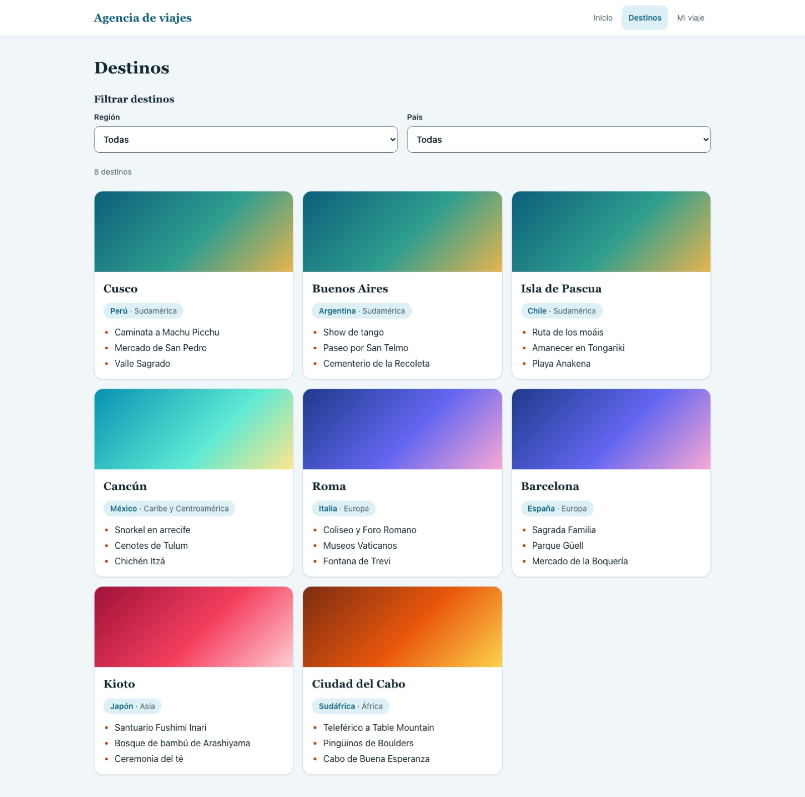
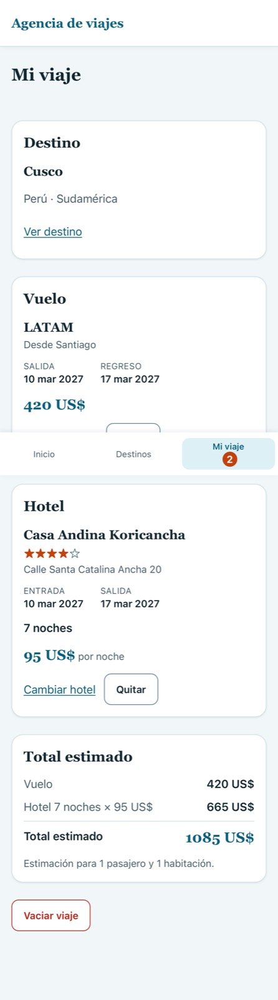
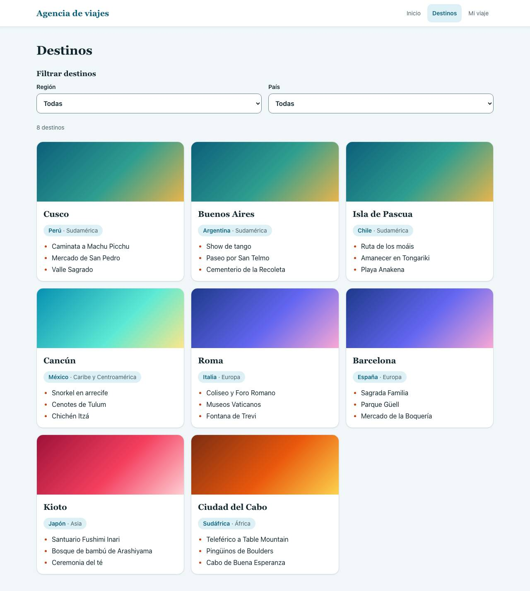
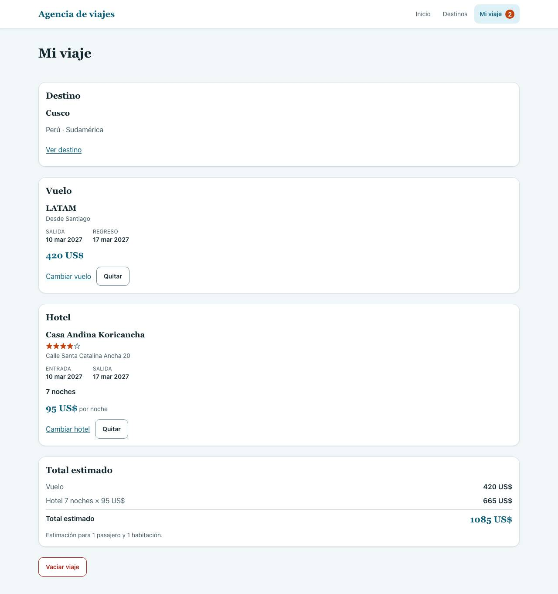

# Agencia de viajes

Aplicación web de una agencia de viajes para la asignatura PFY2202 (Desarrollo Frontend II).
Permite explorar destinos, ver sus vuelos y hoteles, elegir uno de cada y revisar el viaje con su total estimado.
Los datos vienen de APIs mock (REST y GraphQL) que funcionan en el navegador, también en el sitio publicado.

**Sitio publicado:** https://gustavoduocuc.github.io/viajes-gustavo-dominguez-pfy2202

## Funcionalidades

- **Inicio** con destinos destacados.
- **Destinos**: listado de 8 destinos con filtro, y detalle con descripción y actividades populares.
- **Vuelos y hoteles** de cada destino, con filtros (fecha de salida, solo disponibles), indicador de disponibilidad y precios.
- **Mi viaje**: elegir un vuelo y un hotel (las ofertas agotadas no se pueden elegir), ver las noches, el total estimado (vuelo + noches × precio por noche, para 1 pasajero y 1 habitación) y cambiar, quitar o vaciar. Si eliges una oferta de otro destino, el viaje anterior se reemplaza y se avisa.
- El viaje se guarda en el navegador (`localStorage`, clave `viajes.trip`) y se conserva al refrescar.
- Estados de carga, vacío, error y «no encontrado»; diseño responsivo y accesible (navegación por teclado, regiones de estado, foco gestionado).

## Stack

- React 19 y React Router 7 (modo datos)
- Tailwind CSS 3
- API REST mock con MSW (destinos)
- API GraphQL mock con MSW y Apollo Client 4 (vuelos y hoteles)
- Pruebas con Jest y Testing Library

## Instalación y ejecución

Requiere Node 22 (ver `.nvmrc`).

```bash
npm install
npm start                    # desarrollo en http://localhost:3000
npm test -- --watchAll=false # pruebas
npm run build                # compilación de producción en build/
```

La API mock está activa por defecto, también en producción. Para desactivarla al compilar,
define `REACT_APP_USE_MOCKS=false` (ver `.env.example`).

## Requisitos del navegador y problemas conocidos

- La API mock funciona con un *service worker*, así que el navegador debe permitirlos. **No uses una ventana privada de Firefox**: ahí los service workers están deshabilitados y la app mostrará un error de conexión en lugar de datos. Tampoco funcionará si bloqueas los datos de sitios.
- En el sitio publicado, abrir o refrescar una ruta profunda (por ejemplo `/mi-viaje`) muestra un 404 en la consola del navegador: lo emite GitHub Pages antes de servir `404.html`, que carga la aplicación. La navegación interna no tiene este efecto.
- Si Mi viaje aparece con datos de una visita anterior, usa «Vaciar viaje» (el viaje se guarda en `localStorage`).

## Rutas

| Ruta | Pantalla |
|---|---|
| `/` | Inicio con destinos destacados |
| `/destinos` | Listado de destinos con filtro |
| `/destinos/:slug` | Detalle del destino y resumen de ofertas |
| `/destinos/:slug/vuelos` | Vuelos del destino |
| `/destinos/:slug/hoteles` | Hoteles del destino |
| `/mi-viaje` | Viaje elegido, noches y total estimado |
| `*` | Página no encontrada (conserva el menú) |

## API REST (destinos)

| Método y ruta | Respuesta |
|---|---|
| `GET /api/destinations` | `200` con la lista resumida de destinos |
| `GET /api/destinations/:slug` | `200` con el destino completo, o `404` `{ "message": "El destino «x» no existe." }` |

Un destino tiene `id`, `slug`, `name`, `country`, `region`, `description` y `popularActivities`.

## API GraphQL (vuelos y hoteles)

Endpoint `POST /graphql`, consumido con Apollo Client. Consultas:

| Consulta | Variables | Devuelve |
|---|---|---|
| `flights` (`GetFlights`) | `destination: String!`, `date: String` | Vuelos del destino, opcionalmente desde una fecha |
| `hotels` (`GetHotels`) | `destination: String!`, `onlyAvailable: Boolean` | Hoteles del destino, opcionalmente solo con habitaciones |
| `destinationOffers` (`GetDestinationOffers`) | `destination: String!` | Vuelos y hoteles juntos, solo con los campos del resumen |

Ejemplo de petición:

```graphql
query GetFlights($destination: String!, $date: String) {
  flights(destination: $destination, date: $date) {
    id airline origin departureDate returnDate price currency seatsAvailable
  }
}
```

Variables: `{ "destination": "cusco", "date": "2027-04-01" }`

Respuesta:

```json
{
  "data": {
    "flights": [
      {
        "__typename": "Flight",
        "id": "fl-cusco-02",
        "airline": "Sky Airline",
        "origin": "Lima",
        "departureDate": "2027-04-02",
        "returnDate": "2027-04-09",
        "price": 310,
        "currency": "USD",
        "seatsAvailable": 3
      },
      {
        "__typename": "Flight",
        "id": "fl-cusco-03",
        "airline": "JetSMART",
        "origin": "Buenos Aires",
        "departureDate": "2027-05-15",
        "returnDate": "2027-05-22",
        "price": 385,
        "currency": "USD",
        "seatsAvailable": 0
      }
    ]
  }
}
```

Un destino desconocido responde HTTP 200 con `{ "errors": [{ "message": "El destino «x» no existe." }] }`.

## REST vs GraphQL

| Aspecto | REST (destinos) | GraphQL (vuelos y hoteles) |
|---|---|---|
| Endpoint | `GET /api/destinations`, `GET /api/destinations/:slug` | `POST /graphql` (`GetFlights`, `GetHotels`, `GetDestinationOffers`) |
| Qué pide el cliente | La respuesta completa del recurso | Solo los campos que declara la consulta |
| Varias listas | Una petición por recurso | `destinationOffers` trae vuelos y hoteles en una sola |
| Filtros | Se resuelven en el cliente | Variables de la consulta (`date`, `onlyAvailable`) |
| Errores | Código HTTP (404, 500) y `{ message }` | HTTP 200 con `errors: [{ message }]` |
| Cliente | `fetch` y un hook con `useState` y `useEffect` | Apollo Client y `useQuery` (`loading`, `error`, `data`) |
| Caché | Ninguna | Caché en memoria por operación y variables |
| Mock | MSW `http.get` | MSW `graphql.query` |

## Errores simulados

En desarrollo (`npm start`) puedes provocar errores:

- Detalle de destino (REST): abre `/destinos/error-500`.
- Lista de destinos (REST): en la consola del navegador ejecuta `localStorage.mockFail = 'destinations'` y recarga.
- Vuelos y hoteles (GraphQL): `localStorage.mockFail = 'graphql'` y recarga una sección de un destino (por ejemplo `/destinos/cusco/vuelos`).

`mockFail` admite un valor a la vez; quítalo con `localStorage.removeItem('mockFail')`.
En el sitio publicado estos mecanismos están desactivados: `/destinos/error-500` se trata como un destino inexistente.

## Estructura de carpetas

```
src/
  api/          cliente HTTP y funciones de la API REST
  data/         datos semilla (destinos, vuelos, hoteles)
  destinations/ listado y detalle de destinos
  graphql/      cliente Apollo y consultas
  home/         página de inicio
  mocks/        API mock (MSW): handlers, respuestas y consultas
  offers/       vuelos, hoteles, filtros y tarjetas de oferta
  routing/      tabla de rutas y base del router
  shell/        estructura de la app y menú de secciones
  trip/         estado de Mi viaje, cálculos, almacenamiento y pantalla
  ui/           componentes base (botón, tarjeta, campos, estados)
public/         HTML base, worker de la API mock
scripts/        copia index.html a 404.html tras el build
docs/           evidencia de pruebas y capturas
```

## Navegadores probados

| Navegador | Resultado |
|---|---|
| Chrome (Chromium 153) escritorio | Verificado |
| Safari (WebKit 26.6) escritorio | Verificado |
| Chrome en móvil (Pixel 7) | Verificado |
| Safari en móvil (iPhone 13) | Verificado |
| Tablet (iPad Mini, 768 px) | Verificado |
| Firefox | Pendiente de prueba manual |

El detalle está en [docs/testing-evidence.md](docs/testing-evidence.md).

## Capturas

| Destinos | Mi viaje |
|---|---|
|  |  |
|  |  |
|  |  |

La última fila muestra el sitio publicado.

## Publicación

https://gustavoduocuc.github.io/viajes-gustavo-dominguez-pfy2202

El sitio se publica con GitHub Actions al fusionar en `main` (rama `gh-pages`). Se compila con
`PUBLIC_URL=/viajes-gustavo-dominguez-pfy2202`, el router usa esa base y `404.html` es una copia de `index.html`
para que las rutas profundas abran la aplicación (GitHub Pages las responde con 404 pero las muestra bien).
